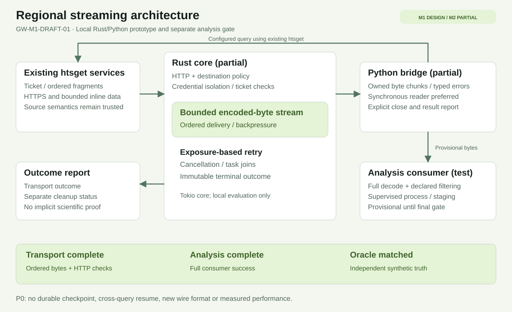

  

<h1 align="center">GeneWire</h1>

  An open protocol for efficient, secure, and resumable genomic data exchange.

<strong>Genomics · Networking · Systems Engineering</strong>

  <a href="docs/project/STATUS.md">Experimental · Pre-alpha · Research and Design</a>
  &nbsp;|&nbsp; <a href="LICENSE">Apache-2.0</a>
  &nbsp;|&nbsp; <a href="CONTRIBUTING.md">Contributions welcome</a>

  <a href="#proposed-architecture">Architecture</a> ·
  <a href="ROADMAP.md">Roadmap</a> ·
  <a href="CONTRIBUTING.md">Contribute</a> ·
  <a href="SECURITY.md">Security</a>

> **Current status:** documentation and visual identity only. GeneWire has no
> implementation, installable package, stable specification, or measured performance
> results. Every capability described below is **proposed**, **planned**, or **under
> research**. The tagline states the project's goal, not an achieved guarantee.

## Overview

GeneWire is an open infrastructure project exploring how genomic datasets could
move reliably between research systems. The initial direction is a versioned
exchange protocol with explicit transfer state, verifiable data boundaries, and
recoverable progress.

Python and asyncio are the proposed reference implementation environment. The
protocol should remain implementable independently and in other languages.
Transport selection, wire encoding, and genomic semantics are not yet decided.

## The problem

A transfer can finish at the byte level while leaving a downstream workflow with
an incomplete set of objects, missing reference context, or an unusable index.
After a connection failure, systems also need a precise answer to a practical
question: **which data has the receiver actually accepted and verified?**

GeneWire proposes making transfer intent, dependencies, integrity, and recovery
explicit. Its first research milestone will test whether a new protocol is
justified, or whether extending existing standards is the better path. No
superiority over existing tools is claimed.

## Why genomic exchange is different

| Concern | Design question |
| --- | --- |
| Related objects | How should a dataset, its index, and required references remain consistent? |
| Format boundaries | When is an opaque byte range safe, and when is format-aware access necessary? |
| Scientific meaning | How are reference identity, coordinate conventions, and provenance preserved? |
| Sensitive metadata | What might filenames, manifests, and access patterns reveal? |
| Recoverable progress | How can a restart avoid accepting stale or corrupted checkpoint state? |

These are design questions. A general byte-transfer layer cannot establish
biological validity, consent, or permission to share a dataset.

## Proposed architecture

The conceptual design separates session control from data movement and keeps
format knowledge behind optional adapters. A manifest would identify the objects
and dependencies in a transfer. The receiver would verify accepted data before
advancing durable recovery state.

  

| Proposed layer | Responsibility | Status |
| --- | --- | --- |
| Session control | Version negotiation, capabilities, transfer identity, errors | Proposed |
| Transfer engine | Bounded streaming, acknowledgements, interruption recovery | Proposed |
| Integrity and persistence | Object verification, checkpoint binding, final acceptance | Under research |
| Genomic adapters | Format metadata, index and reference relationships | Under research |
| Transport and security | Authenticated encryption, identity and authorization integration | Under research |

View the conceptual protocol layers

No frame format, message identifier, port, cryptographic algorithm, or transport
binding has been assigned. These illustrations are non-normative design aids.

## Planned capabilities

- **Planned:** bounded streaming with backpressure and cancellation.
- **Planned:** resumable transfers bound to object identity and verified progress.
- **Planned:** manifests for multi-object datasets and explicit dependencies.
- **Under research:** integrity verification granularity and durable checkpoints.
- **Under research:** authenticated transport and authorization integration.
- **Under research:** format-aware extensions without changing scientific content.
- **Planned:** reproducible interoperability, correctness, and performance tooling.

## Genomic formats roadmap

No format is currently supported. Inclusion here expresses a research sequence,
not a compatibility promise. Opaque transfer and semantic interpretation will be
specified separately.

| Format family | Intended exploration | Earliest target |
| --- | --- | --- |
| FASTA / FASTQ | Opaque objects first; variants, compression and metadata reviewed explicitly | M4 · Planned |
| SAM / BAM | Alignment objects and associated index relationships | M4 · Planned |
| CRAM | Reference dependencies and index relationships | M4 · Under research |
| VCF / BCF | Variant objects, indexes and coordinate metadata | M4 · Under research |
| BED | Feature intervals and coordinate conventions | Later extension · Under research |

Existing standards such as htsget, refget, and Crypt4GH will inform the feasibility
review. GeneWire does not claim conformance to, endorsement by, or replacement of
those projects. See the [primary references](#references).

## Proposed protocol lifecycle

1. Establish a protected connection and validate the peer under a future policy.
2. Negotiate compatible versions, capabilities, and resource limits.
3. Describe transfer objects and dependencies in a proposed manifest.
4. Stream bounded data units with explicit acceptance rules.
5. Verify received data and reject inconsistent state.
6. Persist verified progress; after interruption, reconnect and validate the checkpoint.
7. Finalize only after all required objects satisfy acceptance rules.
8. Close the session and release resources.

This is a discussion model, not an executable interface or normative state machine.

## Design principles

**Correctness before throughput.** Transfer success must have explicit meaning.
**Recovery without ambiguity.** Persisted progress must be bound to the intended
objects and peer context. **Bounded resources.** Untrusted lengths and stalled
peers must not imply unlimited memory or work. **Scientific precision.** Preserve
format and reference semantics. **Interoperability.** Document wire behavior so
independent implementations can agree. **Evidence before claims.** Publish
reproducible methods before making performance claims.

## Development roadmap

| Milestone | Exit evidence |
| --- | --- |
| M0 · Research and Feasibility | Existing-standard comparison and documented go/no-go decision |
| M1 · Protocol Specification | Reviewable state model, wire proposal, threat model and test vectors |
| M2 · Core Protocol | Minimal interoperable session and framing implementation |
| M3 · Reliable Transfer Engine | Verified recovery under interruption and corruption |
| M4 · Genomic Extensions | Reviewed format, reference and index handling |
| M5 · Developer Experience | Working CLI, package, examples and contributor tooling |
| M6 · Alpha Release | Reproducible validation, release notes and documented limitations |

All milestones are planned. There are no delivery-date commitments. See the
[full roadmap](ROADMAP.md), [status](docs/project/STATUS.md), and
[task register](docs/project/TASKS.md).

## Contribute across disciplines

Software engineers, protocol engineers, bioinformaticians, geneticists,
computational biologists, security researchers, technical writers, and performance
engineers are welcome. Useful early work includes sharpening requirements,
reviewing terminology, identifying existing standards, and proposing reproducible
experiments with synthetic data.

Start with [CONTRIBUTING.md](CONTRIBUTING.md), follow our
[Code of Conduct](CODE_OF_CONDUCT.md), and use an appropriate
[issue form](https://github.com/dehghandehnaviamin/GeneWire/issues/new/choose).
Substantial protocol changes begin with a lightweight RFC. For questions, see
[SUPPORT.md](SUPPORT.md) and [GOVERNANCE.md](GOVERNANCE.md).

## Security and privacy

GeneWire is experimental and has not undergone a security audit. There is no
supported software release. Do not use it for clinical decisions or real patient
data. Do not submit identifiable genomic data, credentials, or sensitive metadata
in issues, pull requests, logs, or fixtures.

Encryption and integrity are research requirements, not implemented protections.
Dataset access decisions, consent, retention policy, and authorization remain
deployment responsibilities to be addressed explicitly in future design work.
Report vulnerabilities privately using [SECURITY.md](SECURITY.md).

## License

GeneWire's original code, protocol specifications, documentation, and branding
assets use the [Apache License 2.0](LICENSE), SPDX `Apache-2.0`. Third-party
material retains its stated license; the Contributor Covenant is attributed
separately in [CODE_OF_CONDUCT.md](CODE_OF_CONDUCT.md). See
[licensing decisions](docs/project/DECISIONS.md#d002--one-license-for-original-project-material).

## References

Primary sources for future research; listing a source does not imply conformance:

- [GA4GH HTS specifications](https://samtools.github.io/hts-specs/) — format and related transfer specifications.
- [htsget](https://samtools.github.io/hts-specs/htsget.html) — existing genomic data retrieval protocol.
- [refget](https://samtools.github.io/hts-specs/refget.html) — reference sequence retrieval.
- [Crypt4GH specification](https://samtools.github.io/hts-specs/crypt4gh.pdf) — encryption container for genomic files.
- [IETF RFC 8446](https://www.rfc-editor.org/rfc/rfc8446) — TLS 1.3, a candidate security building block.
- [IETF RFC 9000](https://www.rfc-editor.org/rfc/rfc9000) — QUIC, a candidate transport for evaluation.

Open design. Explicit state. Verifiable progress.

