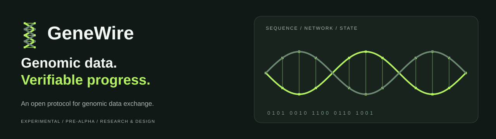
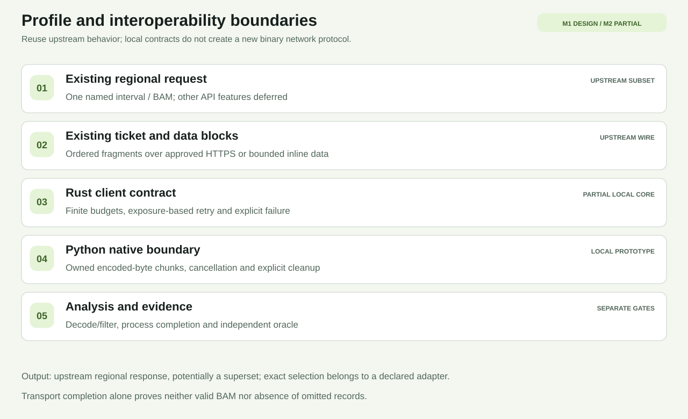
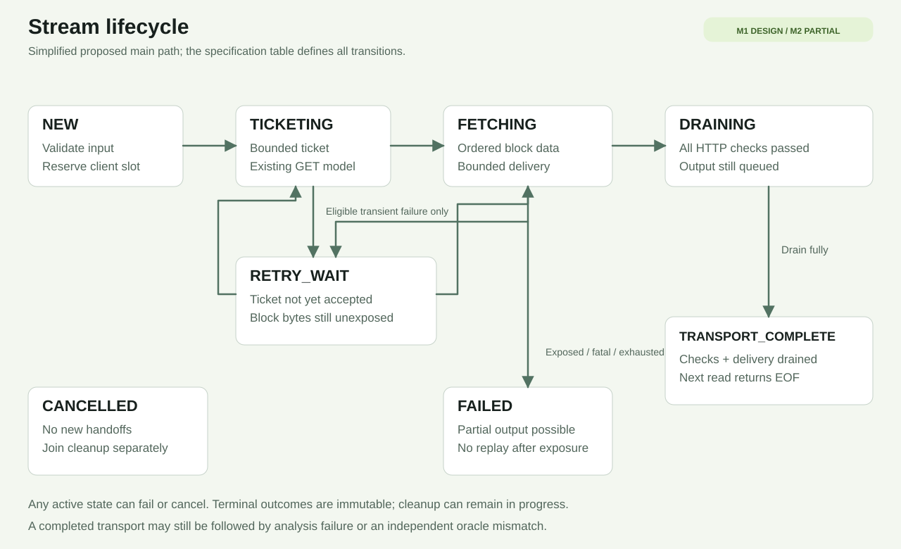

  

<h1 align="center">GeneWire</h1>

  An open protocol for efficient, secure, and resumable genomic data exchange.

<strong>Genomics · Networking · Systems Engineering</strong>

  <a href="docs/project/STATUS.md">Experimental · Pre-alpha · Research and Design</a>
  &nbsp;|&nbsp; <a href="LICENSE">Apache-2.0</a>
  &nbsp;|&nbsp; <a href="CONTRIBUTING.md">Contributions welcome</a>

  <a href="#proposed-architecture">Architecture</a> ·
  <a href="ROADMAP.md">Roadmap</a> ·
  <a href="CONTRIBUTING.md">Contribute</a> ·
  <a href="SECURITY.md">Security</a>

> **Current status:** experimental Rust core and synchronous Python binding, built
> and tested locally and in Linux/macOS CI. The narrow M2 reference path has
> passed its engineering gates. An optional verified-source BAM recovery subset
> also passed Linux/macOS CI; the full M3 milestone remains open.
> There is no released package, full
> conformance result or measured performance comparison. The tagline states the
> project's goal, not an achieved guarantee.

**Current focus:** regional retrieval and streaming for analysis tools, with an
owner-selected **Rust core** and a possible **Python high-level integration**.
The owner authorized advancing M0's direction into
[M1 design](docs/spec/README.md). [RFC 0001](docs/rfcs/0001-regional-streaming-profile.md)
proposes a narrow htsget-oriented BAM stream with explicit failure/completion
semantics. A first local implementation now exercises part of that design. See
[local development](docs/development.md) and [observed evidence/gaps](docs/project/M2-LOCAL.md).

## Overview

GeneWire is an open infrastructure project exploring reliable genomic access
between research systems and analysis tools. The current question is how to
deliver the intended regional result with explicit completion, bounded resource
use and recoverable progress.

Rust is the chosen core direction; Python can provide a convenient analysis and
workflow interface. The local prototype uses Tokio and a synchronous
PyO3/maturin integration. Its current checks cover one macOS/CPython environment;
broader support remains unqualified.
The first proposed subset reuses existing HTTP/htsget behavior; no GeneWire binary
wire format, endpoint or port is assigned.

## The problem

A regional stream can produce decodable output before a later failure reveals
that the analysis result is incomplete. A downstream workflow also needs the
right source, reference context and query semantics. After interruption, systems
need a precise answer to a practical question: **which work can be safely reused,
and which result is actually complete?**

GeneWire proposes making query intent, dependencies, integrity, and recovery
explicit. The initial [standards review](docs/research/standards-comparison.md)
identifies htsget and direct HTSlib access as essential baselines.
The [feasibility recommendation](docs/research/feasibility-decision.md) favors
reuse-first design. No superiority over existing tools is claimed.

## Why genomic exchange is different

| Concern | Design question |
| --- | --- |
| Related objects | How should a dataset, its index, and required references remain consistent? |
| Format boundaries | When is an opaque byte range safe, and when is format-aware access necessary? |
| Scientific meaning | How are reference identity, coordinate conventions, and provenance preserved? |
| Sensitive metadata | What might filenames, manifests, and access patterns reveal? |
| Recoverable progress | How can a restart avoid accepting stale or corrupted checkpoint state? |

These are design questions. A general byte-transfer layer cannot establish
biological validity, consent, or permission to share a dataset.

## Proposed architecture

The proposed M1 subset separates an existing ticket/data service, a bounded Rust
stream engine, the Python boundary and a supervised analysis consumer.
Transport completion, successful analysis and an independent oracle match are
different outcomes. Read the [draft contracts](docs/spec/README.md) for their limits.

  

| Proposed layer | Responsibility | Status |
| --- | --- | --- |
| Upstream adapter | Existing htsget request, ticket and ordered data blocks | Local prototype |
| Rust stream engine | Bounded delivery, exposure-based retry, cancellation and terminal reports | Local prototype |
| Python integration | Owned byte chunks, typed errors and explicit close | Local prototype |
| Analysis boundary | Full decode/filter and separate analysis-completion outcome | Local supervised BAM adapter with provisional staging |
| Network/security policy | Credential isolation, destination checks and finite budgets | Local controls; further review required |

View the conceptual protocol layers

No GeneWire frame, message identifier, port or cryptographic scheme is assigned.
The client profile reuses upstream behavior and intentionally supports a subset;
these diagrams mix the design target with partial local components. The evidence
ledger defines what has actually been exercised.

## Planned capabilities

- **Local prototype:** pull-based byte reads, bounded chunks, cancellation and deadlines.
- **Local prototype:** bounded retries before ticket acceptance or current-block
  exposure; failure reports retain the phase and mark exposed partial output.
- **Local prototype:** supervised full BAM decode/overlap filtering and staged
  output; five synthetic queries matched an independent local htsget server and
  HTSlib clients. See the [evaluation ledger](docs/project/M2-LOCAL.md).
- **M3 job subset:** SHA-256-pinned complete BAM spools and locked job
  receipts recover processing/publication after a process crash. Partial input
  starts a fresh query; see [scope and evidence](docs/project/M3-LOCAL.md).
- **M3 job subset:** cooperative cancellation interrupts blocked input and
  supervised analysis; publication admission preserves accepted output and
  cleanup completion is reported separately. Verified on the observed CI runners.
- **Later / under research:** byte-offset resume, object manifests, multi-object
  recovery and broader storage/durability qualification.
- **Under research:** authenticated transport and authorization integration.
- **Under research:** format-aware extensions without changing scientific content.
- **Planned:** reproducible interoperability, correctness, and performance tooling.

## Genomic formats roadmap

Synthetic BAM byte streams have been exercised with an external HTSlib decoder.
There is no released format-support or real-server compatibility promise. Opaque transfer and semantic interpretation will be
specified separately.

| Format family | Intended exploration | Earliest target |
| --- | --- | --- |
| SAM / BAM | Synthetic indexed BAM is the proposed first regional-evaluation fixture; SAM provides decoded context | Tiny BAM oracle exercised locally; broader extensions at M4 |
| CRAM | Reference arrangements and index relationships need separate review | P1 evaluation · Under research |
| VCF / BCF | Variant overlap, indexes and coordinate semantics need explicit fixtures and baseline checks | P1 evaluation · Under research |
| FASTA / FASTQ | Reference lookup or secondary opaque-object exchange; no assumed reference-coordinate FASTQ API | Later / secondary · Under research |
| BED | Feature intervals and coordinate conventions | Later extension · Under research |

Existing standards such as htsget, refget, and Crypt4GH will inform the feasibility
review. GeneWire does not claim conformance to, endorsement by, or replacement of
those projects. See the [primary references](#references).

## Proposed protocol lifecycle

1. Validate the supported interval, service configuration and finite budgets.
2. Obtain and validate an existing htsget ticket.
3. Apply destination and credential policy to every data request.
4. Deliver ordered encoded bytes while enforcing backpressure.
5. Retry only when current-block exposure and remaining budgets allow it.
6. Drain output before reporting transport completion.
7. Report analysis success only through the separate decoder/consumer gate.
8. Close and join owned work; report unfinished cleanup truthfully.

This is a draft local lifecycle, not a new wire protocol. P0 has no persistent
checkpoint, transparent cross-query resume or exactly-once analysis guarantee.
The optional [M3 job layer](docs/rfcs/0002-recoverable-bam-jobs.md) adds complete-
source reuse and publication receipts without changing that byte-stream contract.

## Design principles

**Correctness before throughput.** Transfer success must have explicit meaning.
**Recovery without ambiguity.** Persisted progress must be bound to the intended
objects and peer context. **Bounded resources.** Untrusted lengths and stalled
peers must not imply unlimited memory or work. **Scientific precision.** Preserve
format and reference semantics. **Interoperability.** Document wire behavior so
independent implementations can agree. **Evidence before claims.** Publish
reproducible methods before making performance claims.

## Development roadmap

| Milestone | Exit evidence |
| --- | --- |
| M0 · Research and Feasibility | Published; owner authorized the reuse-first direction for M1 |
| M1 · Protocol Specification | Design direction adopted locally; 30 candidate scenarios with partial executable evidence |
| M2 · Core Protocol | Narrow BAM reference path passed real-server/HTSlib, failure/resource and Linux/macOS CI checks |
| M3 · Reliable Transfer Engine | First verified-BAM-job subset passed Linux/macOS CI; full milestone and broader durability open |
| M4 · Genomic Extensions | Reviewed format, reference and index handling |
| M5 · Developer Experience | Working CLI, package, examples and contributor tooling |
| M6 · Alpha Release | Reproducible validation, release notes and documented limitations |

M1 remains provisional beyond the implemented subset; M2's narrow engineering
gate is complete; the first M3 subset passed CI and M4–M6 are planned. There are no delivery-date commitments. See the
[full roadmap](ROADMAP.md), [status](docs/project/STATUS.md), and
[task register](docs/project/TASKS.md).

## Contribute across disciplines

Software engineers, protocol engineers, bioinformaticians, geneticists,
computational biologists, security researchers, technical writers, and performance
engineers are welcome. Useful early work includes sharpening requirements,
reviewing terminology, identifying existing standards, and proposing reproducible
experiments with synthetic data.

Start with [CONTRIBUTING.md](CONTRIBUTING.md), follow our
[Code of Conduct](CODE_OF_CONDUCT.md), and use an appropriate
[issue form](https://github.com/dehghandehnaviamin/GeneWire/issues/new/choose).
Substantial protocol changes begin with a lightweight RFC. For questions, see
[SUPPORT.md](SUPPORT.md) and [GOVERNANCE.md](GOVERNANCE.md).

## Security and privacy

GeneWire is experimental and has not undergone a security audit. There is no
supported software release. Do not use it for clinical decisions or real patient
data. Do not submit identifiable genomic data, credentials, or sensitive metadata
in issues, pull requests, logs, or fixtures.

The prototype requires verified HTTPS outside explicit loopback tests. Successful
transport does not establish genomic completeness or cryptographic source integrity.
Dataset access decisions, consent, retention policy, and authorization remain
deployment responsibilities to be addressed explicitly in future design work.
Report vulnerabilities privately using [SECURITY.md](SECURITY.md).

## License

GeneWire's original code, protocol specifications, documentation, and branding
assets use the [Apache License 2.0](LICENSE), SPDX `Apache-2.0`. Third-party
material retains its stated license; the Contributor Covenant is attributed
separately in [CODE_OF_CONDUCT.md](CODE_OF_CONDUCT.md). See
[licensing decisions](docs/project/DECISIONS.md#d002--one-license-for-original-project-material).

## References

Primary sources for future research; listing a source does not imply conformance:

- [GA4GH HTS specifications](https://samtools.github.io/hts-specs/) — format and related transfer specifications.
- [htsget](https://samtools.github.io/hts-specs/htsget.html) — existing genomic data retrieval protocol.
- [refget](https://samtools.github.io/hts-specs/refget.html) — reference sequence retrieval.
- [Crypt4GH specification](https://samtools.github.io/hts-specs/crypt4gh.pdf) — encryption container for genomic files.
- [IETF RFC 8446](https://www.rfc-editor.org/rfc/rfc8446) — TLS 1.3, a candidate security building block.
- [IETF RFC 9000](https://www.rfc-editor.org/rfc/rfc9000) — QUIC, a candidate transport for evaluation.

Open design. Explicit state. Verifiable progress.

